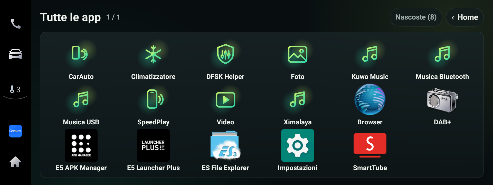

# DFSK Glory 600 – community mods (head unit DFSK_F508_G, Android 9)

> **Unofficial. Not affiliated with DFSK, Seres or the head-unit maker. Use at your own risk.**
> Nothing here writes to `/system`: every app installs in `/data` and is removed with a normal uninstall.
> Restore to stock before dealership service (see [docs/INSTALL.md](docs/INSTALL.md)).
> No video while driving, nothing touches cameras, sensors or safety systems.

🇮🇹 [Leggimi in italiano](README_IT.md)

▶ **[Demo video](docs/demo.mp4)** (25 s, Android emulator: on the emulator the climate is simulated, on the car it drives the real one)



## Problems this fixes

Everyday annoyances of the stock head unit, and what to do about each one.

### CarPlay (SpeedPlay)
| Problem | Fix |
|---|---|
| **Music stops every time you shift into reverse** and doesn't always come back | DFSK Helper: choose *Ducked* or *Lower* – music keeps playing, quieter, while the camera is on |
| **Steering-wheel volume keys don't change call volume** during CarPlay calls | DFSK Helper: wheel keys control the call volume while a call is active |
| **People hear you distorted / too loud** on CarPlay calls | Stock mic gain is ×5. Setting `persist.suding.mic.gainlevel.default` to 1 fixes it (needs system privileges, see [TECH_NOTES](docs/TECH_NOTES.md)) |
| **Car Wi-Fi drops right after start-up** | Not a bug: with the iPhone's Bluetooth on, CarPlay over Bluetooth takes over the `ap0` hotspot. Use the cable, or turn the phone's Bluetooth off for car Wi-Fi |
| No way to see if CarPlay is connected from the home screen | Home CyberZec shows a CarPlay chip (`bw.carplay.connect.state` 2 = cable) |

### Climate
| Problem | Fix |
|---|---|
| **"Face" mode doesn't blow on your face**, the MODE button seems to do nothing | Windscreen defrost is on: it keeps the air on the glass whatever mode you pick. Home CyberZec shows a warning |
| Pressing + seems to do nothing | Each press is half a level. Home CyberZec shows "4,5" |
| Rear window defrost doesn't switch on | It only works with the engine running |
| Climate is hidden behind menus | Home CyberZec: every control on the home screen, big buttons |

### Language and home screen
| Problem | Fix |
|---|---|
| Stock apps half in English/Chinese, **camera app forced to English** | Italian translation overlays for 16 apps (translate to your language by copying a folder) |
| After start-up the home screen still shows the old texts | The stock launcher starts before translations load: restarting it fixes it (DFSK Helper system build does it automatically) |
| Small text and icons, hard to read while driving | Home CyberZec: sizes from Android's "Design for Driving" guidelines |
| Useless apps (duplicate navigators, updater, tools) in the app list | Home CyberZec: long-press → hide |

## What's inside

| Folder | What it is | Tested on the car |
|---|---|---|
| [`home/`](home) | **Home CyberZec** – a driver-friendly launcher with real climate control | ✅ (see note below) |
| [`helper/`](helper) | **DFSK Helper** – CarPlay music keeps playing in reverse, steering-wheel call volume | ✅ |
| [`translations/`](translations) | Italian translation of 16 stock apps, as RRO overlays | ✅ (see note below) |
| [`icons/`](icons) | "Aurora" icon set (generator + SVG) | ✅ |
| [`docs/`](docs) | Install / restore guide, technical notes for developers | – |

**Language:** both apps are in English, and switch to Italian automatically when the unit's language is Italian. More languages welcome: the texts are in `Logic.t()` / `Lang.t()` calls.

**Note:** on the author's car these were signed with a different key. The builds in this repo use your own key; they compile, but the Home climate control and the overlays still need a test with this signing. Please report in Issues.

### Home CyberZec
- Big, glanceable UI (Android "Design for Driving" sizes): clock + date, CarPlay / Wi-Fi / GPS / outside-temperature chips.
- **Climate control**: on/off, level in half steps (blue − / red +), fan 0–8, 4 air modes with icons, A/C, recirculation, windscreen and rear-window defrost. Shows the real state read from the car.
- Weather by GPS (Open-Meteo, no API key) with city name, cached for offline use.
- Swipe right for all apps.
- **Configure it from the app itself, no settings files:** long-press an app → put it in the bottom bar (6 slots) or hide it; "Hidden (N)" brings apps back.

### DFSK Helper
- **Reverse gear + CarPlay**: stock unit pauses your music every time you reverse. Choose Pause (stock) / Ducked / Lower.
- **Call volume from the steering wheel** during CarPlay calls.
- All options are switches in the app; status screen shows what the unit reports.

## Tested on

| | |
|---|---|
| Car | DFSK Glory 600 (bought July 2025, EU / Italy) |
| Android model (`Build.MODEL`) | `DFSK_F508_G` |
| Platform | Yato1, Autochips / MediaTek **AC8257**, Android 9 |
| OS firmware | `OS_Yato1_DFSK-F508-G_01_V2.44.00_241107` |
| MCU firmware | `MCU_Yato1_DFSK-F508-G_01_V1.18.00_241107` |
| CarPlay | SpeedPlay `com.suding.speedplay` (wired) |

Other units with the same Yato1 / AC8257 platform and BW apps (e.g. DFSK E5 `DFSK-S508L-G`, other DFSK / Seres models) may work but are **not tested**. If you try, open an Issue with your `OS_…` and `MCU_…` versions (Settings → System info).

## Restore to stock
Going to the dealership? `./restore_stock.sh` (dry run first, then `--yes`) removes Home CyberZec, DFSK Helper and the translations and brings back the stock Home. Nothing is written to `/system`. Details: [docs/INSTALL.md](docs/INSTALL.md#restore-to-stock).

## Build
No Gradle. Needs Android SDK build-tools 35.0.0, platform android-28, a JDK.
```
bash home/build.sh
bash helper/build.sh
bash translations/build_overlays.sh   # needs framework-res.apk from your car, see the script header
```
Each script runs its self-tests first.

## Contributing
Other trims, model years and similar F508 / MediaTek units are welcome: open an Issue with what you tested.
Translations to other languages: copy a `translations/<App>/values-it` folder to your language.
Technical findings are in [docs/TECH_NOTES.md](docs/TECH_NOTES.md).

License: MIT.
