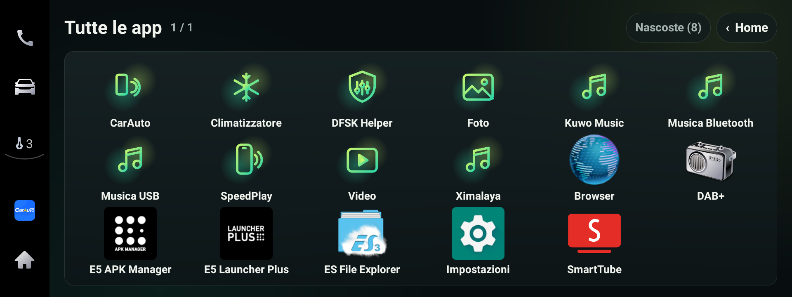

# DFSK Glory 600 – modifiche della community (unità DFSK_F508_G, Android 9)

> **Non ufficiale, non legato a DFSK, Seres o al produttore dell'unità. Lo usi a tuo rischio.**
> Niente viene scritto in `/system`: le app si installano in `/data` e si tolgono con una normale disinstallazione.
> Prima del tagliando torna all'originale (vedi [docs/INSTALL.md](docs/INSTALL.md)).
> Niente video alla guida; nulla tocca telecamere, sensori o sistemi di sicurezza.

▶ **[Video demo](docs/demo.mp4)** (emulatore: lì il clima è simulato, in auto comanda quello vero)

## Cosa c'è
- **`home/` – Home CyberZec**: Home grande e leggibile alla guida, clima completo (⏻, livello a mezzi scatti, ventola, 4 modalità aria, A/C, ricircolo, parabrezza, lunotto), meteo con città, stato CarPlay/Wi-Fi/GPS/temperatura esterna. **Si configura dall'app**: tieni premuta un'app per metterla nella barra o nasconderla.
- **`helper/` – DFSK Helper**: la musica CarPlay non va più in pausa in retromarcia (Pausa / Attenuata / Più bassa); volume chiamata dai tasti al volante.
- **`translations/`**: traduzione italiana di 16 app di serie (overlay RRO).
- **`icons/`**: set di icone "Aurora".

Le build di questo repo usano una chiave tua: si compilano, ma clima della Home e overlay vanno riprovati in auto con questa firma. Segnalalo nelle Issues.

Compilazione e note tecniche: vedi [README.md](README.md) e [docs/](docs). Licenza MIT.
